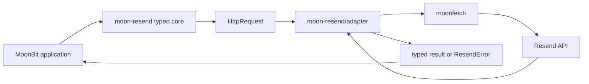

# Architecture

The core owns Resend semantics: validation, endpoint paths, JSON and typed API errors. The adapter owns network I/O, TLS and timeouts. Keeping that boundary visible makes the core deterministic to test and lets another runtime adapter be added without duplicating the API implementation.

## Failure model

| Failure | Result |
| --- | --- |
| Invalid email or lifecycle input | `InvalidInput` before network I/O |
| Resend returns a non-2xx status | `Api` with status, name, message and raw body |
| Resend returns malformed success JSON | `InvalidResponse` |
| DNS, TCP, TLS or timeout failure | `Transport` |

Redirects are disabled by the official adapter so the bearer token cannot be forwarded to a redirected origin.
